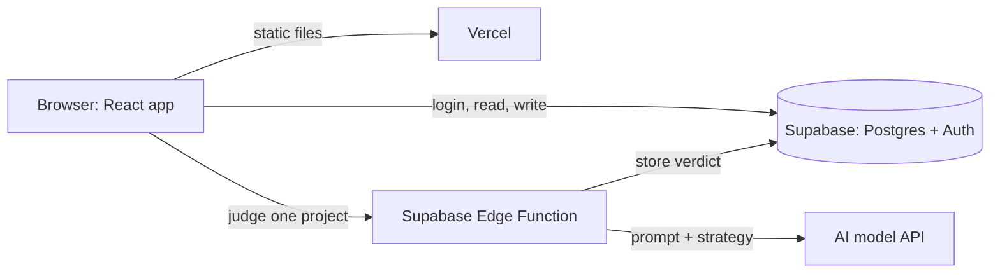

# Clavus: tech stack

What Clavus is built with, and why. For what the product does, see [README.md](README.md).

Two constraints drove every choice: the prototype must run **entirely on free tiers**, and it must **look and behave like a product**, not a data script.

## The stack

| Layer | Choice | Why |
|---|---|---|
| Interface | React + Vite (TypeScript) | Full control over the screens that sell the product (the map and the review table). Builds to static files, so any host can serve it for free. |
| Hosting | Vercel, free plan | Deploys from GitHub on every push. It only serves static files here, so moving host later takes minutes. |
| Database and logins | Supabase (Postgres) | Hosted and always on, with authentication and per-table access rules built in. Nothing to deploy or maintain. |
| Server code | Supabase Edge Functions | Keeps the AI key private and calls the model. Puts the whole back end in one place, so the host stays static. |
| Counting | SQL in Supabase | The percentages on the map come from queries over stored verdicts, so they are exact and repeatable. |
| File import | Parsed in the browser | Work items arrive as CSV. The user maps columns to the common format before anything is stored. |
| Charts | A React chart library | For the effort map. |
| AI model | **Not chosen yet** | See below. |

## How the pieces connect

No always-on server is needed. Everything the server side does is a short request: take an upload, judge one project, read or write a row.

## AI model

Still open. Whatever is chosen has to:

- return **structured JSON** in a fixed shape;
- have a **free tier** that covers a full run (about 60 calls, one per project) several times a day;
- be callable over plain HTTPS from an Edge Function.

Candidates so far: Gemini Flash-Lite and Mistral. Free tiers change often and may use prompts for training, so the prototype sends **synthetic data only**.

The model sits behind a single function. Switching provider means editing one file.

## Design rules

1. **One project per call.** Each project is sent with its child items, and the interface shows progress. This keeps every request short.
2. **Fixed output shape.** Each verdict contains: `serves`, `none`, `contradicts` or `unclear`; the priority concerned; the quoted strategy line; a short reason.
3. **Quotes are checked in code.** After each call, the quoted line must appear in the strategy text, or the verdict is rejected.
4. **Verdicts are stored.** An unchanged project is never judged twice, which keeps results stable and usage low.
5. **The model never counts.** Totals and percentages are computed in SQL.
6. **Access rules on every table.** Each user sees only their own company's data.

## Data model (first draft)

| Table | Holds |
|---|---|
| `strategies` | One strategy per company, with its text |
| `priorities` | The priorities and "will not do" items of a strategy |
| `work_items` | Imported items in the common format, with their parent project |
| `verdicts` | The model's judgement per project, with quote and reason |
| `overrides` | Human corrections, with who made them and when |

## Alternatives considered

| Option | Why not |
|---|---|
| Streamlit (Python) | Fastest to build, but every app looks the same and the interface can't be customised much. |
| Next.js | Its built-in server routes are convenient, but they tie the server code to the host. Plain React keeps the host replaceable. |
| An always-on server (for example FastAPI) | Nothing in Clavus needs a running process, and free always-on hosting tends to sleep when idle. |
| SQLite | Serverless hosts have no permanent disk to keep the file on. |

## Free-tier limits to watch

Checked in November 2026 from third-party pricing guides. Verify before relying on them.

- **Vercel free plan:** personal, non-commercial use only. If Clavus ever earns money, move the static files to a host that allows it, such as Cloudflare Pages.
- **Supabase free plan:** projects pause after 7 days without activity and need a manual restart; 500 MB database; no backups. Open the app in the week before any demo.
- **Model free tiers:** request limits are low and change without notice.

A real deployment with customer data would need paid plans for the database and the model.
